# CRM data model

PostgreSQL 17, schema owned by Flyway (`V6` onwards). Conventions of the boilerplate apply:
`BIGSERIAL` ids, `created_at` / `updated_at` as `TIMESTAMP WITH TIME ZONE` in UTC, a `version`
column for optimistic locking (`AuditableEntity`).

## Relationships

```mermaid
erDiagram
  users ||--o{ workspace_members : "is member"
  workspaces ||--o{ workspace_members : has
  workspaces ||--o{ workspace_invitations : has
  workspaces ||--o{ pipeline_stages : has
  workspaces ||--o{ lead_sources : has
  workspaces ||--o{ audit_events : has
  workspace_members |o--o{ companies : owns
  workspace_members |o--o{ contacts : owns
  workspace_members |o--o{ leads : owns
  workspace_members |o--o{ deals : owns
  workspace_members |o--o{ tasks : "assigned"
  workspace_members |o--o{ activities : "wrote"
  companies |o--o{ contacts : employs
  companies |o--o{ deals : "buys in"
  contacts |o--o{ deals : "primary contact"
  pipeline_stages ||--o{ deals : "current stage"
  deals ||--o{ deal_stage_changes : history
  lead_sources |o--o{ leads : source
  lead_sources |o--o{ contacts : source
  lead_sources |o--o{ deals : source
  leads |o--o| deals : "converted into"
  companies |o--o{ tasks : about
  contacts |o--o{ tasks : about
  leads |o--o{ tasks : about
  deals |o--o{ tasks : about
  companies |o--o{ activities : about
  contacts |o--o{ activities : about
  leads |o--o{ activities : about
  deals |o--o{ activities : about
```

## The tenant boundary

- Every CRM table has `workspace_id BIGINT NOT NULL REFERENCES workspaces(id)`.
- Every table that other CRM rows point to has `UNIQUE (workspace_id, id)`, and every reference
  is a **composite** foreign key: `(workspace_id, company_id) REFERENCES companies (workspace_id,
  id)`. A row can only point to rows of its own workspace, whatever the application does.
- People are referenced through their membership: `(workspace_id, owner_id) REFERENCES
  workspace_members (workspace_id, user_id) ON DELETE SET NULL (owner_id)`. Only members can own
  records, and removing a member (or deleting the account, which cascades to its memberships)
  leaves their records unassigned instead of deleting them.
- In JPA, workspace-owned entities extend `WorkspaceOwnedEntity` (`@TenantId workspaceId`). Links
  are mapped as plain id columns (`Long companyId`) written by services, plus read-only
  `@ManyToOne` associations on the same column where a query needs to join.

## Tables

`text?` means nullable. Lengths are the API's validation limits too.

### Accounts and workspaces

| Table | Columns | Constraints and indexes |
|---|---|---|
| `users` (existing) | + `display_name varchar(100)?` | |
| `workspaces` | `name varchar(100)`, `default_currency char(3)`, `timezone varchar(64)` | |
| `workspace_members` | `workspace_id`, `user_id → users ON DELETE CASCADE`, `role varchar(16)` (`OWNER`, `ADMIN`, `MANAGER`, `SALES_REP`) | `UNIQUE (workspace_id, user_id)`; index `(user_id)` |
| `workspace_invitations` | `workspace_id`, `email varchar(254)` (lower case), `role`, `token_hash varchar(64)` (SHA-256 hex, `UNIQUE`), `invited_by → users ON DELETE SET NULL`, `expires_at`, `accepted_at?`, `revoked_at?` | partial `UNIQUE (workspace_id, email) WHERE accepted_at IS NULL AND revoked_at IS NULL`; index `(invited_by)` |
| `audit_events` | `workspace_id` (plain FK), `occurred_at`, `actor_id?` (no FK: history outlives accounts), `actor_email?`, `action varchar(32)`, `entity_type varchar(32)`, `entity_id`, `entity_label varchar(200)?`, `changes jsonb`, `request_id varchar(64)?` | append-only (trigger refuses `UPDATE`/`DELETE`); indexes `(workspace_id, occurred_at DESC)`, `(workspace_id, entity_type, entity_id, occurred_at DESC)` |

Workspaces are never hard-deleted (deleting a workspace is a non-goal; there is no endpoint and
no cascade). That is why `audit_events.workspace_id` is a plain foreign key and the trail can stay
append-only: nothing ever has to delete its rows.

### Reference data

| Table | Columns | Constraints |
|---|---|---|
| `pipeline_stages` | `workspace_id`, `name varchar(60)`, `position int`, `probability smallint` (0-100), `kind varchar(8)` (`OPEN`, `WON`, `LOST`) | `UNIQUE (workspace_id, id)`; `UNIQUE (workspace_id, lower(name))`; one `WON` and one `LOST` per workspace (partial unique indexes) |
| `lead_sources` | `workspace_id`, `name varchar(60)`, `archived_at?` | `UNIQUE (workspace_id, id)`; `UNIQUE (workspace_id, lower(name))` |

A new workspace gets the default stages ([README](README.md#deal)) and sources (Website,
Referral, Event, Outbound, Partner, Other) in the transaction that creates it.

### Records

| Table | Columns |
|---|---|
| `companies` | `name varchar(200)`, `industry varchar(100)?`, `website varchar(255)?`, `phone varchar(50)?`, `address varchar(500)?`, `employee_count int?`, `owner_id?`, `notes varchar(5000)?`, `archived_at?` |
| `contacts` | `first_name varchar(100)`, `last_name varchar(100)?`, `email varchar(254)?`, `phone varchar(50)?`, `job_title varchar(100)?`, `company_id?`, `owner_id?`, `source_id?`, `tags text[]` (lower case, ≤ 20 of ≤ 40 chars), `notes?`, `archived_at?` |
| `leads` | `first_name`, `last_name?`, `company_name varchar(200)?`, `email?`, `phone?`, `job_title?`, `source_id?`, `owner_id?`, `status varchar(16)`, `priority varchar(8)` (`LOW`, `MEDIUM`, `HIGH`), `follow_up_date date?`, `estimated_value numeric(15,2)?` + `currency char(3)?`, `unqualified_reason varchar(500)?`, `notes?`, `converted_at?`, `converted_company_id?`, `converted_contact_id?`, `converted_deal_id?`, `archived_at?` |
| `deals` | `name varchar(200)`, `amount numeric(15,2) ≥ 0`, `currency char(3)`, `stage_id`, `probability smallint?` (override), `expected_close_date date?`, `owner_id?`, `company_id?`, `contact_id?`, `source_id?`, `lead_id?` (`UNIQUE`: one deal per converted lead), `lost_reason varchar(500)?`, `closed_at?`, `notes?`, `archived_at?` |
| `deal_stage_changes` | `deal_id`, `from_stage_id?` + `from_stage_name varchar(60)?` (both null for the first entry), `to_stage_id?` + `to_stage_name varchar(60)`, `changed_by?` (user id, no FK: history outlives memberships and accounts), `changed_at`; the names are snapshots taken at the change, the ids `ON DELETE SET NULL (column)` so deleting a stage keeps the rows; the app only inserts, no `updated_at` or `version`, and no append-only trigger (SET NULL updates rows) |
| `tasks` | `title varchar(200)`, `description varchar(5000)?`, `due_at timestamptz?`, `priority varchar(8)` (`LOW`, `MEDIUM`, `HIGH`), `status varchar(16)` (`OPEN`, `COMPLETED`, `CANCELLED`), `assignee_id?`, `created_by?` (user id; a member foreign key like the owners: `ON DELETE SET NULL (created_by)`, so a creator who leaves becomes null), `completed_at?` (`CHECK`: set exactly when `COMPLETED`), `company_id?`, `contact_id?`, `lead_id?`, `deal_id?` |
| `activities` | `type varchar(16)` (`CALL`, `EMAIL`, `MEETING`, `NOTE`), `subject varchar(200)`, `body varchar(5000)?`, `occurred_at`, `author_id?`, `company_id?`, `contact_id?`, `lead_id?`, `deal_id?`; `CHECK` at least one link |

Foreign keys use `ON DELETE RESTRICT` (records are archived, never deleted; `deal_stage_changes →
deals` too), except `deal_stage_changes → pipeline_stages`, which is `SET NULL` on the stage id
column: the history keeps the stage's name. Removing a pipeline stage or lead source in use fails
with a foreign-key error, which the API reports as 409 before it gets that far.

Indexes: every foreign key; `(workspace_id, lower(name))` on companies;
`(workspace_id, lower(email))` on contacts and leads; `GIN (tags)` on contacts;
`(workspace_id, status)` on leads; `(workspace_id, stage_id)` and `(workspace_id, closed_at)` on
deals; `(workspace_id, assignee_id, status, due_at)` on tasks (the reminders and `mine`);
`(workspace_id, occurred_at DESC)` on activities. Substring search (`ILIKE '%q%'`) scans within one
workspace, which is fine at SMB scale; `pg_trgm` indexes are the upgrade path.

## Derived values (not stored)

- A task's `overdue`: `OPEN` and `due_at` before now.
- A deal's status: its stage's kind. Its effective probability: `COALESCE(deals.probability,
  stage.probability)`.
- Counts and totals on the dashboard and reports: computed by queries on request.
- "Contact count" and "open deal count" of a company: one grouped count query per page of
  companies (by the page's ids), not subqueries in the list query.

## Development data

`app.demo.enabled=true` (env `DEMO_DATA=true`, local and dev profiles only) creates, once, a demo
workspace with a few members and fictional companies, contacts, leads, deals, tasks and
activities using `example.com` addresses. It is never part of a migration, so production never gets
it.
